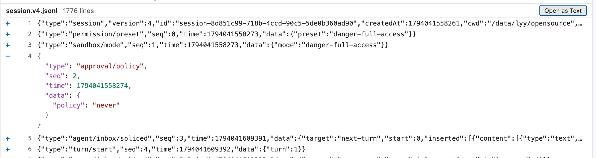

# JSONL Viewer for VS Code

以「每行一个可展开的 JSON」的方式查看 `.jsonl` / `.ndjson` 文件，而不是把整个文件当成一个数组渲染。



## 功能

- 每行左侧一个 `+`，点击只在原位展开这一行的 JSON（格式化并高亮），再点 `−` 收起。
- 展开时按**原文 token 重排**，不做 `JSON.parse` → `JSON.stringify` 往返：大整数、`1e400`、重复 key、转义序列都按文件里的原样显示。
- 虚拟滚动：只渲染视口附近的行，几十 MB 的文件也能流畅滚动。
- 无效 JSON 行展开时会显示解析错误，并保留原始文本。
- 跟随 VS Code 主题（深色/浅色/高对比度）和编辑器字体。

## 安装

两种方式，装完都要执行一次 **Reload Window**（`Cmd/Ctrl+Shift+P` → `Developer: Reload Window`），自定义编辑器和快捷键才会注册。

**命令行**

```bash
code --install-extension jsonl-for-vscode-*.vsix
```

macOS 上提示 `code: command not found` 时，用 VS Code 的完整路径：

```bash
"/Applications/Visual Studio Code.app/Contents/Resources/app/bin/code" \
  --install-extension jsonl-for-vscode-*.vsix
```

**图形界面**

1. `Cmd/Ctrl+Shift+X` 打开扩展视图；
2. 点扩展视图右上角的 `...` → **Install from VSIX...**；
3. 选中 `jsonl-for-vscode-*.vsix`，等右下角提示后点 **Reload**。

装好后扩展列表里会多出 **JSONL Viewer**（扩展 ID `historyliao.jsonl-for-vscode`）。

## 使用

默认**不会**抢占 `.jsonl` 的默认编辑器，避免影响你平时直接编辑文件。四种打开方式：

1. **快捷键 `Cmd+Alt+J`（macOS）/ `Ctrl+Alt+J`（Windows、Linux）**，光标在 `.jsonl` / `.ndjson` 文本编辑器里时按下即可；
2. 资源管理器中右键 `.jsonl` 文件 → **Open with JSONL Viewer**；
3. 打开文件后按 `Cmd/Ctrl+Shift+P` → **Open with JSONL Viewer**；
4. 打开文件后 `Cmd/Ctrl+Shift+P` → **Reopen Editor With...** → **JSONL Viewer**。

快捷键在任意文本编辑器里都能用（不限于 `.jsonl`），但焦点在查看器里时不生效，切回文本请用右上角 **Open as Text**。改键方法见下一节。


想让 `.jsonl` 默认用查看器打开，在用户设置里加：

```json
"workbench.editorAssociations": {
  "*.jsonl": "jsonlViewer.editor",
  "*.ndjson": "jsonlViewer.editor"
}
```

查看器里点右上角 **Open as Text**，或 **Reopen Editor With... → Text Editor**，即可切回普通文本编辑器修改文件。

## 自定义快捷键

默认绑定是 `Cmd+Alt+J`（macOS）/ `Ctrl+Alt+J`（Windows、Linux），命令 ID 为 `jsonlViewer.open`。下面两种改法任选其一。

### 方式一：键盘快捷方式编辑器（推荐）

1. 按 `Cmd+K` 松开，再按 `Cmd+S`（macOS）；Windows/Linux 为 `Ctrl+K` 松开，再按 `Ctrl+S`。
   等价入口：`Cmd/Ctrl+Shift+P` → **Preferences: Open Keyboard Shortcuts**。
2. 顶部搜索框输入 `jsonlViewer.open`，或直接搜命令标题 `Open with JSONL Viewer`。
3. 鼠标移到这一行，点行首出现的铅笔图标（也可以双击该行）。
4. 弹出 `Press desired key combination and then press ENTER` 后**一次性按下**想要的组合（例如 `⌘⇧J`），按 `Esc` 可取消。
5. 若提示该组合已被占用，会列出冲突的命令：确认覆盖就继续按 `Enter`；拿不准就先按 `Esc` 取消，再右键该条目 → **Show Same Keybindings** 看清是谁在用。
6. 改完立即生效，不需要 Reload Window。

> 想连触发条件一起改：右键该条目 → **Change When Expression**。当前默认值是 `editorTextFocus`，含义是“焦点在文本编辑器里”。

### 方式二：编辑 keybindings.json

适合多机同步、或想给绑定写注释说明用途。

1. `Cmd/Ctrl+Shift+P` → **Preferences: Open Keyboard Shortcuts (JSON)**；
2. 在数组里加入一条（用户级配置的优先级高于扩展自带的默认值）：

```json
[
  {
    "key": "cmd+shift+j",
    "command": "jsonlViewer.open",
    "when": "editorTextFocus"
  }
]
```

3. 保存即生效。

macOS 与 Windows/Linux 想用不同组合时，用上下文键 `isMac` / `isWindows` / `isLinux` 分开写。注意用户级 `keybindings.json` 里没有 `mac`、`win`、`linux` 字段，那是扩展 `package.json` 贡献点的写法：

```json
[
  { "key": "cmd+shift+j", "command": "jsonlViewer.open", "when": "editorTextFocus && isMac" },
  { "key": "ctrl+alt+j", "command": "jsonlViewer.open", "when": "editorTextFocus && !isMac" }
]
```

### 恢复默认

- 图形界面：在键盘快捷方式里找到该条目 → 右键 → **Reset Keybinding**，恢复成 `⌘⌥J` / `Ctrl+Alt+J`；
- `keybindings.json`：删掉对应条目并保存。

### 按了没反应怎么查

1. 确认焦点在文本编辑器正文里——侧边栏、终端、以及查看器 webview 里都不会触发；
2. 在键盘快捷方式里搜 `jsonlViewer.open`，确认右侧显示的键就是你设的那个；
3. 右键该条目 → **Show Same Keybindings**，看是否有别的命令占着同一个组合；
4. `Cmd/Ctrl+Shift+P` → **Developer: Toggle Keyboard Shortcuts Troubleshooting**，再按你的组合，然后看 `Output` 面板的 **Keyboard Shortcuts** 输出：
   - `command: jsonlViewer.open`：正常触发；
   - `command: -`：按键被 `when` 条件挡住；
   - 完全没有输出：键被系统或其它软件（Raycast、Alfred、输入法等）截获，只能换一个组合。

## 已知限制

- **128 MB 上限**：超过后不会加载，视图里会提示并让你用 **Open as Text** 打开。
- 文件内容在打开时**整体从扩展宿主传到 webview**，内存约为文件大小的 2 倍；几十 MB 可以接受，接近上限时会明显变慢。
- 只读视图；文件在磁盘上被外部修改后，需要关闭并重新打开。
- 目前没有文件内搜索；也没有持久化展开状态。
- 从右侧资源管理器打开的文件如果正在文本编辑器里有未保存修改，查看器读到的是磁盘上的内容。

## 开发

```bash
npm install
npm run compile   # tsc -> out/
```

在 VS Code 里按 `F5` 启动 Extension Development Host，打开任意 `.jsonl` 文件，然后 **Reopen Editor With... → JSONL Viewer**。

不启动 VS Code 也可以单独看 webview 的渲染效果：用浏览器直接打开 `media/preview.html`，它用一份 mock 数据和一个假的 `acquireVsCodeApi` 驱动同一套 `main.js` / `style.css`。

## 构建 .vsix

前置：Node.js ≥ 18 与 npm（本项目在 Node v24 上验证过），本机不需要装 VS Code。

```bash
# 1. 安装依赖（含 typescript 和 @vscode/vsce）
npm install

# 2. 编译 TypeScript，产出 out/extension.js
npm run compile

# 3. 打包
npx vsce package        # 等价于 npm run package
```

执行完当前目录会生成 `jsonl-for-vscode-<version>.vsix`，版本号取自 `package.json` 的 `version`。

几点说明：

- `vsce package` 会先触发 `package.json` 里的 `vscode:prepublish`（也就是 `npm run compile`），所以第 2 步可以省略；单独跑一次只是为了让编译错误更早暴露。
- **本地打包不需要登录，也不需要 Personal Access Token**；只有 `vsce publish` 发布到 Marketplace 才需要。
- 进包内容由 `.vscodeignore` 决定：`src/`、`tsconfig.json`、`node_modules/`、`media/preview.html`、`*.map` 会被排除，`out/`、`media/`、`README.md`、`package.json` 会进包。
- 打包时提示 `LICENSE, LICENSE.md, or LICENSE.txt not found` 属于警告，不影响本地安装。
- 产物平台无关（纯 JS，无原生模块），Linux 上打好的包可以直接装到 Apple Silicon 的 macOS。
- 装包方式见上面的[安装](#安装)一节。

## 目录结构

```
src/extension.ts   扩展宿主：CustomReadonlyEditorProvider、文件读取、webview 消息通道
media/main.js      webview：虚拟列表、就地展开、JSON 高亮
media/style.css    webview：主题变量与布局
media/preview.html 仅开发用的独立预览页（不打包进 vsix）
media/screenshot.png README 里的效果图
```
